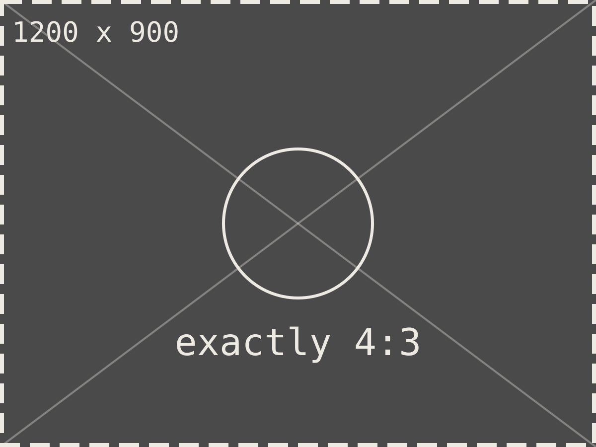
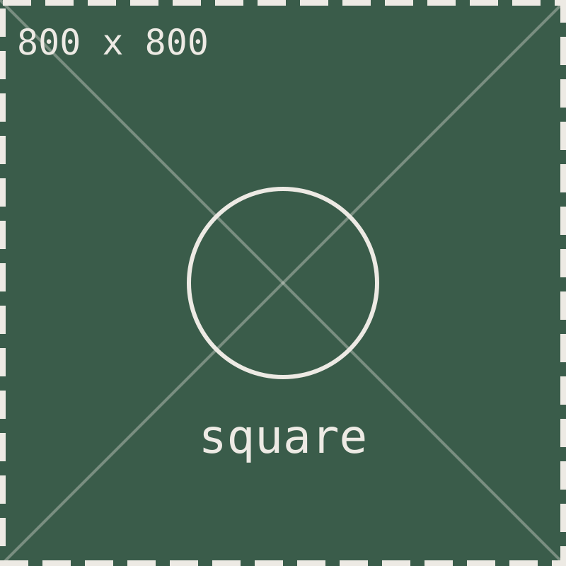

%% Test note for every layout. Run `npm run demo`, open demo/ as a vault, and check it in reading view AND Live Preview (Ctrl/Cmd+E toggles). Each image shows its own size; the dashed border and diagonals show what a 4:3 crop cuts off. %%

## 1. Figures: one image on its own line

With a caption. Expect the image at its natural shape and the caption underneath:

![[wide.svg|A wide image keeps its shape]]

No caption. Expect no caption line:

![[tall.svg]]

A width hint is not a caption. Expect a 300px-wide image and no "300" caption:

![[square.svg|300]]

A Markdown image. Expect "Markdown alt text is the caption":



## 2. Rows: several images on one line

Three, mixed shapes and captions. Expect three equal 4:3 cells; the third has no caption:

![[wide.svg|Wide, cropped]] ![[tall.svg|Tall, cropped]] ![[square.svg]]

Two. On a phone this is the same; three or more drop to two across (reading view):

![[before.svg|Before]] ![[after.svg|After]]

Markdown images in a row:

 

## 3. Galleries

Two columns with a title. Expect a 2x2 grid of 4:3 cells and "Before and after the redesign" underneath, with no callout box or icon:

> [!gallery|2] Before and after the redesign
> ![[before.svg]]
> ![[after.svg]]
> ![[before-mobile.svg]]
> ![[after-mobile.svg]]

No column count. Expect 3 columns (the image count, up to 3) and per-image captions under each cell:

> [!gallery] Default columns
> ![[wide.svg|One]]
> ![[tall.svg|Two]]
> ![[square.svg|Three]]
> ![[four-three.svg|Four]]

No title. Expect 2 columns from the image count and no caption at all (not "Gallery"):

> [!gallery]
> ![[before.svg]] ![[after.svg]]

Four columns:

> [!gallery|4] Four across
> ![[wide.svg]]
> ![[tall.svg]]
> ![[square.svg]]
> ![[four-three.svg]]

## 4. Left alone

Text with an inline image stays a normal paragraph: here is ![[square.svg|40]] in a sentence.

A note embed on the same line is not an image row:

![[four-three.svg]] ![[Embedded note]]

Inside a code block the syntax stays as source in Live Preview:

```md
![[wide.svg|Not laid out]] ![[tall.svg|Not laid out]]
```

A normal callout keeps its box:

> [!note] A note callout
> ![[square.svg|200]]

## 5. Asides: an image next to text

Right (the default) with a title. Expect the text on the left, the image on the right with "The ridge from the east" under it, and no callout box or "Aside" label. The text follows the image on the next line, in the same paragraph:

> [!aside|right] The ridge from the east
> ![[wide.svg]]
> The path climbs steadily for two hours. There is water at the second stream crossing and nowhere after it, so fill up there.
>
> A second paragraph stays in the text column.

Left, no title. Expect the image on the left and no caption:

> [!aside|left]
> ![[tall.svg]]
>
> A tall image on the left, with its text beside it. On a phone this stacks, image first.

No image. Expect the text on its own:

> [!aside] Just text
> Nothing to put beside it.
